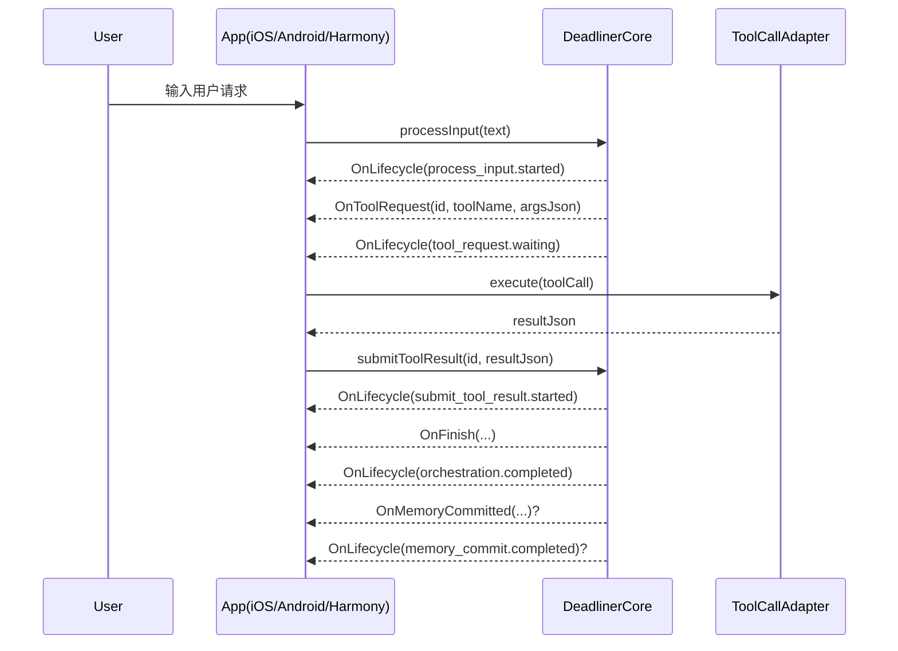

# Deadliner Agent 全平台适配文档

本文件定义 iOS / Android / Harmony 统一适配协议，目标是：

1. 跨端统一 Agent 生命周期状态机
2. 跨端统一 Tool Call 协议与执行约束
3. 通过 `ToolCallAdapter` 承接除 `chat/memory` 之外的业务操作

> 适用版本：当前 `core_logic`（含 `OnLifecycle`、P1 闸门、严格 tool-call 模式）

---

## 1. 设计目标

### 1.1 单一规则源

- LLM 只负责路由与工具决策。
- 任务/习惯域操作必须通过工具调用执行。
- 宿主端（iOS/Android/Harmony）通过同一套 Adapter 契约执行工具。

### 1.2 无软兜底

- TaskAgent / HabitAgent 若未给出合法 tool call，Core 直接报错。
- 工具失败后的重试只允许“同工具改参数”，禁止换工具。

### 1.3 可演进

- 内部 Agent 架构可变；对外生命周期和 Tool Call 协议保持稳定。

---

## 2. 对外事件（CoreEvent）

当前宿主端应消费以下事件：

- `OnLifecycle { requestId, stage, status, message }`
- `OnThinking { agentName/agent_name, phase, message }`
- `OnTextStream { chunk }`
- `OnToolRequest { id, toolName/tool_name, argsJson/args_json }`
- `OnFinish { ... }`
- `OnMemoryCommitted { ... }`
- `OnError { message }`

说明：字段命名在各 FFI 层会有 camelCase / snake_case 差异，语义一致。

---

## 3. 统一生命周期规约

以 `OnLifecycle` 作为跨端状态机唯一驱动输入。

### 3.1 stage/status

- `process_input.started`
- `process_input.failed`
- `submit_tool_result.started`
- `submit_tool_result.failed`
- `tool_request.waiting`
- `orchestration.completed`
- `memory_commit.completed`
- `memory_commit.failed`

### 3.2 requestId 语义

- `requestId` 标识一次入口调用生命周期（`processInput` 或 `submitToolResult`）。
- 宿主端可据此做链路追踪、埋点聚合、UI 状态绑定。

### 3.3 宿主状态机建议

- `started` -> `Running`
- `tool_request.waiting` -> `WaitingTool`
- `orchestration.completed` -> `Finished`
- `memory_commit.completed` -> `MemorySynced`
- `*.failed` -> `Failed`

可直接复用 [Lifecycle.md](/Users/aritxonly/Codes/Agent/deadliner_core/apis/Lifecycle.md) 中定义。

---

## 4. Tool Call 协议

## 4.1 当前工具集合（skills）

### Task 域

- `read_tasks`
- `create_task`
- `update_deadline`

### Habit 域

- `read_habits`
- `create_habit`

## 4.2 Agent 约束

- TaskAgent 只能使用 task 域工具。
- HabitAgent 只能使用 habit 域工具。
- Task/Habit 路由命中后，必须至少返回一个 tool call。
- 禁止“提议模式”直出：
  - TaskAgent 不能直接产出 `tasks` 作为最终执行路径。
  - HabitAgent 不能直接产出 `habits` 作为最终执行路径。

## 4.3 OnToolRequest 载荷

`OnToolRequest.argsJson` 为工具参数 JSON，可能包含 `_meta`：

- `_meta.executionMode`: `AUTO` | `ASK_USER` | `NEVER`
- `_meta.retryCount`: `u64`（失败重试轮次）
- `_meta.retryFromErrorCode`: string（失败来源错误码）

宿主端应保留 `_meta` 透传语义，不做破坏性重写。

---

## 5. ToolCallAdapter 统一接口

建议三端都实现统一抽象（命名可本地化）。

```ts
interface ToolCallAdapter {
  execute(call: {
    id: string;
    toolName: string;
    argsJson: string;
  }): Promise<{ resultJson: string }>;
}
```

### 5.1 执行职责

- 参数解析与 schema 校验（可选再校验）
- 本地能力调用（DB/Repo/Service）
- 产出结构化结果 JSON
- 回灌 `submitToolResult(id, resultJson)`

### 5.2 统一错误输出建议

工具失败时，返回统一结构：

```json
{
  "ok": false,
  "errorCode": "DB_TIMEOUT",
  "message": "query timeout"
}
```

Core 将据此触发失败重试收敛策略（同工具改参，禁止换工具）。

---

## 6. 端到端时序（推荐）



---

## 7. P1 行为对适配层的影响

### 7.1 调用置信度闸门

- 低置信度 tool call 会被标记为 `executionMode=ASK_USER`。
- 宿主端应在 `ASK_USER` 时展示确认 UI，再决定是否执行。

### 7.2 工具失败重试收敛

- 若 resultJson 表示失败，Core 会在下一轮只允许同工具重试。
- 若模型尝试换工具，Core 会直接拒绝（InvalidToolCall）。

### 7.3 Observation 绑定检查

- `submitToolResult` 后，Core 要求答案吸收 observation 关键字段。
- 若未吸收，会触发一次受限重生成（宿主端无感，但可在日志看到）。

---

## 8. 平台落地要点

## 8.1 iOS

- 建议 `CoreCallback.onEvent` 内按 `OnLifecycle` 驱动状态机。
- `OnToolRequest` -> 本地 `ToolCallAdapter` -> `submitToolResult`。

## 8.2 Android

- 同步按 `OnLifecycle` 状态机处理。
- Core 日志可直接过滤 `tag:DeadlinerCore` 追踪工具与生命周期。

## 8.3 Harmony

- `ffi_ohos` 当前为事件队列模型（`drain_events_json()`）。
- 建议以事件消费循环驱动统一状态机与 Adapter 调度。

---

## 9. Adapter 返回 JSON 参考

### 9.1 read_tasks

```json
{
  "tasks": [
    {
      "id": 1,
      "name": "开会",
      "due": "2026-04-15T15:00:00",
      "status": "OPEN",
      "notePreview": "项目例会"
    }
  ],
  "summary": {
    "count": 1,
    "dueSoon24h": 0,
    "overdue": 0
  }
}
```

### 9.2 create_task

```json
{
  "ok": true,
  "task": {
    "id": 12,
    "name": "写周报",
    "due": "2026-04-13T10:00:00"
  }
}
```

### 9.3 create_habit

```json
{
  "ok": true,
  "habit": {
    "id": 31,
    "name": "早起",
    "period": "DAILY",
    "timesPerPeriod": 1,
    "goalType": "COUNT"
  }
}
```

---

## 10. 版本演进建议

- 保持 `OnLifecycle` 与 `OnToolRequest` 结构稳定。
- 新增工具优先走 `skills` 配置 + ToolCallAdapter 执行，不走宿主特判。
- 任何新增 stage/status 必须先补生命周期契约测试与快照 fixture。
